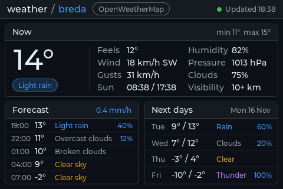

*Nederlands: [README.nl.md](README.nl.md)*

# Breda Weather — weather station on a Wemos LOLIN32 Lite with an Adafruit 3.5" TFT

Fetches the current weather and the forecast for Breda from OpenWeatherMap
every 10 minutes and shows it in landscape (480 × 320) in the style of GitHub:
the weather right now, the coming hours and the coming four days.



*The picture is a render of the screen code on a PC, not a photo of the display.*

> **Status:** the project compiles with ESP-IDF v5.5.3 and the screen layout
> and forecast parser were tested on a PC. It has not been run on the
> hardware yet.

This is a test project to see how this board and display work together. The
display is used without touch for now.

## Parts

| Part | Notes |
|---|---|
| Wemos LOLIN32 Lite | Classic ESP32 (ESP32-D0WDQ6), 4 MB flash, no PSRAM, micro-USB |
| Adafruit 3.5" TFT 320x480 breakout (product 2050) | HX8357D controller; the older version with a single row of solder pads |
| 9 jumper wires and a breadboard | Keep the wires short (10 cm is fine) |
| Micro-USB cable that carries data | Not a charge-only cable |

You also need a free OpenWeatherMap account with an API key, and a 2.4 GHz
Wi-Fi network.

## Wiring

**First close the IM2 solder jumper** on the back of the display board with a
blob of solder. That puts the display in SPI mode. Without it the screen
stays white.

| Display pin | LOLIN32 Lite pin | Function |
|---|---|---|
| GND | GND | Ground |
| Vin | 3V | Power (the board has no 5 V pin; 3.3 V works) |
| 3Vo | not connected | This is an output |
| CLK | 18 | SPI clock |
| MISO | 19 | SPI data from the display (optional, not used yet) |
| MOSI | 23 | SPI data to the display |
| CS | 5 | Chip select |
| D/C | 17 | Data/command |
| RST | 16 | Reset |
| Lite | not connected | Backlight; it is on when left open |
| Y+, X+, Y-, X- | not connected | Touch (not used yet) |
| CCS, CD | not connected | SD card (not used) |

The pins are set in `main/board_config.h`.

To switch the backlight from the program, connect **Lite** to a free pin
(for example 4) and set `PIN_LCD_BL` in `main/board_config.h` to that number.

## 1. Once: install ESP-IDF

1. Install [VS Code](https://code.visualstudio.com/) and open the Extensions view.
2. Search for **ESP-IDF** and install the extension by Espressif Systems.
3. In the setup wizard choose **Express**, select version **v5.5.3** (or
   newer) and click Install. This takes a while.

## 2. Fill in the API key and Wi-Fi

Create an account at <https://home.openweathermap.org/users/sign_up> and copy
your key from <https://home.openweathermap.org/api_keys>.

Copy **`main/credentials.example.h`** to **`main/credentials.h`** and fill in:

```c
#define WIFI_SSID       "your-wifi-name"
#define WIFI_PASSWORD   "your-wifi-password"
#define OWM_API_KEY     "paste-your-api-key-here"
```

A new API key can take a few hours to become active. Until then the screen
shows a red dot with "HTTP 401".

## 3. Build and upload

Open an "ESP-IDF Terminal" in VS Code (or a terminal where ESP-IDF is
loaded), go to the project folder and type:

```
idf.py set-target esp32
idf.py build flash monitor
```

Note the target: **`esp32`**, not `esp32s3`. Stop the monitor with **Ctrl+]**.

The first build takes a few minutes: LVGL is downloaded automatically to
`managed_components/`.

If the upload cannot find the board, pass the port yourself, for example
`idf.py -p /dev/cu.usbserial-XXXX flash monitor` on macOS.

## How the program works

```
app_main()                       main.c
 ├─ display_init()               display_port.c  SPI bus, display, LVGL task
 │    └─ hx8357_init()           hx8357.c        start-up commands for the display
 ├─ ui_create()                  ui.c            build the screen
 ├─ wifi_start()                 wifi.c          connect in the background
 └─ weather_task (own task)      main.c
      loop: wait for Wi-Fi → weather_fetch() → ui_update() → wait 10 min
                                 weather.c       HTTPS + parse JSON
```

Two tasks run at the same time: the **LVGL task** (draws the screen) and the
**weather task** (fetches the data). LVGL may only be used by one task at a
time, which is why every UI call from the weather task sits between
`display_lock()` and `display_unlock()`.

The board has no PSRAM, so memory is tight. Two things follow from that:

- LVGL draws the screen in strips of 32 lines instead of a whole frame.
- The 5-day forecast (about 20 kB of JSON) is never held in memory as a
  whole. `weather.c` cuts out one forecast at a time while the answer comes in.

| File | What's in it | Change it? |
|---|---|---|
| `main/credentials.h` | Wi-Fi, API key, location, refresh time | **Yes** |
| `main/board_config.h` | Pins, SPI speed, screen upside down | If you wire it differently |
| `main/ui.c` | The screen: layout, colours, texts | To taste |
| `main/weather.c` | API calls and JSON parsing | If you want more data |
| `main/hx8357.c` | Driver for the display controller | No |
| `main/display_port.c` | Connects LVGL to the display | No |
| `main/wifi.c` | Wi-Fi connection | No |
| `main/main.c` | Start-up and the weather task | No |
| `sdkconfig.defaults` | Settings (target, flash size, fonts, HTTPS) | Rarely |

## Customising

- **Light theme**: in `main/ui.c`, set `#define UI_DARK_THEME` to `0`.
- **Screen upside down**: in `main/board_config.h`, set `LCD_FLIPPED` to `1`.
- **Another city**: change `WEATHER_CITY`, `WEATHER_LAT` and `WEATHER_LON` in `credentials.h`.
- **Faster screen refresh**: raise `LCD_SPI_HZ` in `main/board_config.h` (short wires needed).
- **Another font size**: only fonts enabled in `sdkconfig.defaults`
  (12, 14, 16, 48) are available. If you add one, delete the `sdkconfig`
  file so the settings are read again.

## Troubleshooting

| On the screen / in the monitor | Cause |
|---|---|
| White screen | IM2 jumper not closed, or a wire on the wrong pin |
| Black screen | No power on Vin, or the upload did not succeed |
| Wrong colours or stripes | Loose wire, or `LCD_SPI_HZ` too high for the wires |
| Board keeps restarting ("Brownout" in the monitor) | The 3.3 V regulator cannot power display and Wi-Fi together; use a better USB port or cable |
| "No Wi-Fi: check credentials.h" | Wrong SSID/password, or a 5 GHz network |
| "HTTP 401: API key invalid..." | Key copied incorrectly, or not active yet |
| "No connection to API" | Internet or DNS does not work through this network |
| Picture is upside down | Set `LCD_FLIPPED` to `1` (see above) |

The monitor shows log lines such as `I (5123) wifi: Connected, IP address: 192.168.1.42`
that show exactly where things go wrong.
