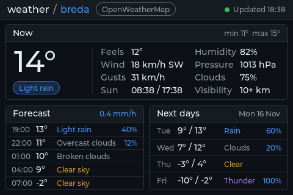
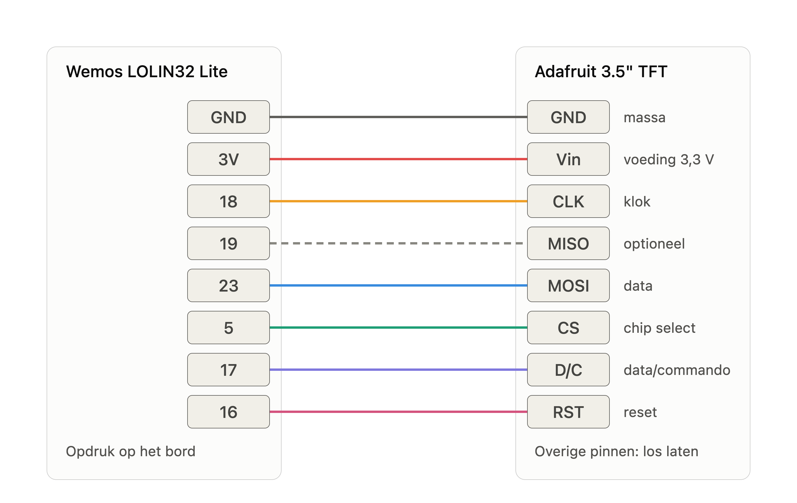

*English: [README.md](README.md)*

# Breda Weather — weerstation op een Wemos LOLIN32 Lite met een Adafruit 3.5" TFT

Haalt elke 10 minuten het actuele weer en de verwachting voor Breda op bij
OpenWeatherMap en toont die liggend (480 × 320) in de stijl van GitHub: het
weer van nu, de komende uren en de komende vier dagen.



*De afbeelding is een weergave van de schermcode op een pc, geen foto van het scherm.*

> **Status:** het project compileert met ESP-IDF v5.5.3, en de schermindeling
> en de verwerking van de verwachting zijn op een pc getest. Het heeft nog
> niet op de hardware gedraaid.

Dit is een testproject om te zien hoe dit bord en dit scherm samenwerken. Het
scherm wordt voorlopig zonder touch gebruikt. De teksten op het scherm zijn
Engels.

## Onderdelen

| Onderdeel | Opmerkingen |
|---|---|
| Wemos LOLIN32 Lite | Klassieke ESP32 (ESP32-D0WDQ6), 4 MB flash, geen PSRAM, micro-USB |
| Adafruit 3.5" TFT 320x480 breakout (product 2050) | HX8357D-controller; de oudere versie met één rij soldeerpunten |
| 9 jumperdraden en een breadboard | Houd de draden kort (10 cm is prima) |
| Micro-USB-kabel die data doorgeeft | Geen kabel die alleen laadt |

Je hebt ook een gratis OpenWeatherMap-account met een API-key nodig, en een
wifi-netwerk op 2,4 GHz.

## Aansluiten

**Soldeer eerst de IM2-jumper dicht** op de achterkant van het schermbord,
met een druppel soldeer. Daarmee staat het scherm in SPI-modus. Zonder die
jumper blijft het scherm wit.

| Pin op het scherm | Pin op de LOLIN32 Lite | Functie |
|---|---|---|
| GND | GND | Massa |
| Vin | 3V | Voeding (het bord heeft geen 5 V-pin; 3,3 V werkt) |
| 3Vo | niet aansluiten | Dit is een uitgang |
| CLK | 18 | SPI-klok |
| MISO | 19 | SPI-data van het scherm (optioneel, nog niet gebruikt) |
| MOSI | 23 | SPI-data naar het scherm |
| CS | 5 | Chip select |
| D/C | 17 | Data/commando |
| RST | 16 | Reset |
| Lite | niet aansluiten | Achtergrondverlichting; die is aan als de pin los blijft |
| Y+, X+, Y-, X- | niet aansluiten | Touch (nog niet gebruikt) |
| CCS, CD | niet aansluiten | SD-kaart (niet gebruikt) |



De pinnen staan in `main/board_config.h`.

Wil je de achtergrondverlichting vanuit het programma schakelen, verbind dan
**Lite** met een vrije pin (bijvoorbeeld 4) en zet `PIN_LCD_BL` in
`main/board_config.h` op dat nummer.

## 1. Eenmalig: ESP-IDF installeren

1. Installeer [VS Code](https://code.visualstudio.com/) en open het Extensions-scherm.
2. Zoek op **ESP-IDF** en installeer de extensie van Espressif Systems.
3. Kies in de installatiewizard **Express**, selecteer versie **v5.5.3** (of
   nieuwer) en klik op Install. Dit duurt even.

## 2. API-key en wifi invullen

Maak een account aan op <https://home.openweathermap.org/users/sign_up> en
kopieer je key van <https://home.openweathermap.org/api_keys>.

Kopieer **`main/credentials.example.h`** naar **`main/credentials.h`** en vul in:

```c
#define WIFI_SSID       "your-wifi-name"
#define WIFI_PASSWORD   "your-wifi-password"
#define OWM_API_KEY     "paste-your-api-key-here"
```

Een nieuwe API-key kan een paar uur nodig hebben voordat hij werkt. Tot die
tijd toont het scherm een rood bolletje met "HTTP 401".

## 3. Bouwen en uploaden

Open een "ESP-IDF Terminal" in VS Code (of een terminal waarin ESP-IDF is
geladen), ga naar de projectmap en typ:

```
idf.py set-target esp32
idf.py build flash monitor
```

Let op het target: **`esp32`**, niet `esp32s3`. Stop de monitor met **Ctrl+]**.

De eerste build duurt een paar minuten: LVGL wordt automatisch gedownload
naar `managed_components/`.

Vindt de upload het bord niet, geef dan zelf de poort op, bijvoorbeeld
`idf.py -p /dev/cu.usbserial-XXXX flash monitor` op macOS.

## Hoe het programma werkt

```
app_main()                       main.c
 ├─ display_init()               display_port.c  SPI-bus, scherm, LVGL-taak
 │    └─ hx8357_init()           hx8357.c        opstartcommando's voor het scherm
 ├─ ui_create()                  ui.c            het scherm opbouwen
 ├─ wifi_start()                 wifi.c          op de achtergrond verbinden
 └─ weather_task (eigen taak)    main.c
      lus: wacht op wifi → weather_fetch() → ui_update() → wacht 10 min
                                 weather.c       HTTPS + JSON uitpakken
```

Er lopen twee taken tegelijk: de **LVGL-taak** (tekent het scherm) en de
**weer-taak** (haalt de data op). LVGL mag maar door één taak tegelijk
gebruikt worden. Daarom staat elke UI-aanroep vanuit de weer-taak tussen
`display_lock()` en `display_unlock()`.

Het bord heeft geen PSRAM, dus het geheugen is krap. Daar volgen twee dingen uit:

- LVGL tekent het scherm in stroken van 32 regels in plaats van een heel beeld.
- De verwachting voor 5 dagen (ongeveer 20 kB JSON) staat nooit in één keer
  in het geheugen. `weather.c` knipt er één verwachting tegelijk uit terwijl
  het antwoord binnenkomt.

| Bestand | Wat erin staat | Aanpassen? |
|---|---|---|
| `main/credentials.h` | Wifi, API-key, locatie, verversingstijd | **Ja** |
| `main/board_config.h` | Pinnen, SPI-snelheid, scherm op zijn kop | Als je anders aansluit |
| `main/ui.c` | Het scherm: indeling, kleuren, teksten | Naar smaak |
| `main/weather.c` | API-aanroepen en JSON uitpakken | Als je meer data wilt |
| `main/hx8357.c` | Driver voor de schermcontroller | Nee |
| `main/display_port.c` | Koppelt LVGL aan het scherm | Nee |
| `main/wifi.c` | Wifi-verbinding | Nee |
| `main/main.c` | Opstarten en de weer-taak | Nee |
| `sdkconfig.defaults` | Instellingen (target, flashgrootte, fonts, HTTPS) | Zelden |

## Aanpassen

- **Licht thema**: zet in `main/ui.c` de regel `#define UI_DARK_THEME` op `0`.
- **Scherm op zijn kop**: zet in `main/board_config.h` `LCD_FLIPPED` op `1`.
- **Andere stad**: wijzig `WEATHER_CITY`, `WEATHER_LAT` en `WEATHER_LON` in `credentials.h`.
- **Sneller scherm**: verhoog `LCD_SPI_HZ` in `main/board_config.h` (korte draden nodig).
- **Andere lettergrootte**: alleen de fonts die in `sdkconfig.defaults` aan
  staan (12, 14, 16, 48) zijn beschikbaar. Voeg je er een toe, verwijder dan
  het bestand `sdkconfig`, zodat de instellingen opnieuw worden gelezen.

## Problemen oplossen

| Op het scherm / in de monitor | Oorzaak |
|---|---|
| Wit scherm | IM2-jumper niet dicht, of een draad op de verkeerde pin |
| Zwart scherm | Geen voeding op Vin, of de upload is niet gelukt |
| Verkeerde kleuren of strepen | Losse draad, of `LCD_SPI_HZ` te hoog voor de draden |
| Bord start steeds opnieuw ("Brownout" in de monitor) | De 3,3 V-regelaar kan scherm en wifi niet samen voeden; gebruik een betere USB-poort of kabel |
| "No Wi-Fi: check credentials.h" | Verkeerde SSID of wachtwoord, of een 5 GHz-netwerk |
| "HTTP 401: API key invalid..." | Key verkeerd gekopieerd, of nog niet actief |
| "No connection to API" | Internet of DNS werkt niet via dit netwerk |
| Beeld staat op zijn kop | Zet `LCD_FLIPPED` op `1` (zie hierboven) |

De monitor toont logregels zoals `I (5123) wifi: Connected, IP address: 192.168.1.42`
waaraan je precies ziet waar het misgaat.
